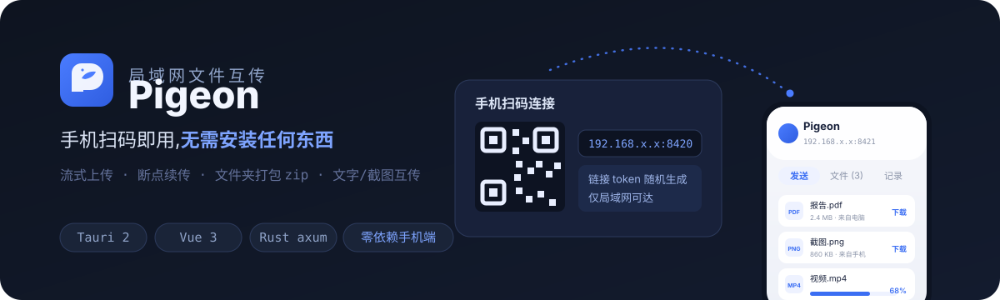
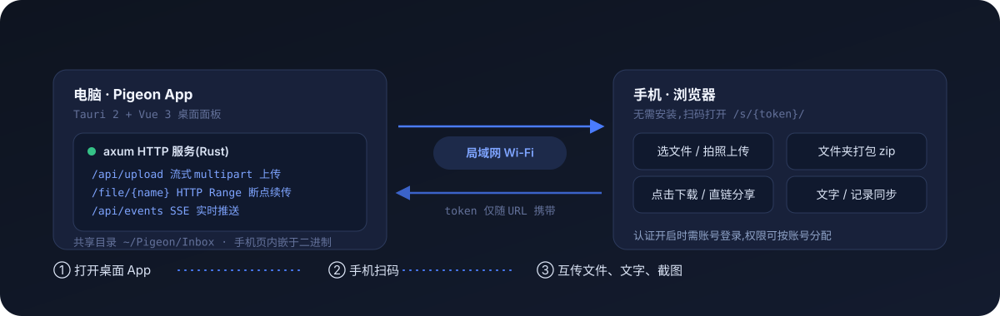

<p align="center">
  
</p>

# Pigeon 🕊️

**局域网里的 AirDrop**:电脑与手机互传文件、文字、截图。手机扫码即用,**无需安装任何东西**——手机页面内嵌在桌面 App 里,打开浏览器就是全部。

<p align="center">
  
</p>

## 功能

**传输**

- **手机 → 电脑** :选文件/拍照/选文件夹(自动打包 zip),流式上传,实时进度 + 速度 + 剩余时间
- **电脑 → 手机** :拖文件进窗口或点击选择;手机端列表实时刷新,点击下载
- **文件夹分享** :拖入文件夹自动打包成 zip,手机直接下载
- **断点续传** :下载支持 HTTP Range(206),配合 FDM 等多线程下载器可跑满带宽、中断续传
- **文字/截图互传** :文字双向同步并写剪贴板,桌面 Ctrl+V 直接发截图;手机记录可搜索、单条删除

**连接**

- **免输地址** :桌面端显示二维码 + 链接,扫码即连
- **单文件直链** :悬停复制单个下载链接,发给同一网络里的任何人
- **手机拖拽上传**(桌面浏览器):文件拖进手机页任意位置即可发送

**安全**

- 每次启动生成随机 token,只在 URL 中携带
- 可选账号认证,按账号分配 下载/上传/删除 权限
- 文件名清洗防路径穿越;服务仅监听局域网,关闭 App 即下线

## 上手

从 [Releases](https://github.com/TIUCSIB/Pigeon/releases) 下载安装包,或自己构建:

```bash
pnpm install
pnpm tauri build   # 产出 NSIS 安装包 + exe
```

> Windows 首次运行会弹防火墙授权,请点"允许",否则手机无法访问。

设置持久化在 `~/Pigeon/settings.json`,也可在应用内"设置"面板修改:

| 项 | 默认 | 说明 |
|---|---|---|
| `port` | `8420` | HTTP 监听端口,`0` 为自动分配;改动需重启,被占用时自动回落 |
| `inbox_dir` | 空(`~/Pigeon/Inbox`) | 共享收件目录,应用内修改立即生效 |

## 技术栈

- **桌面** :Tauri 2 + Vue 3 + TypeScript
- **服务** :Rust(axum + tokio),流式 multipart 上传、SSE 推送、限速与并发队列
- **手机端** :零依赖——HTML/CSS/JS 内嵌在二进制里,无 CDN、无构建,亮暗主题跟随电脑端设置

## 路线图

- [ ] mDNS(`pigeon.local`)设备发现
- [ ] 手机端多选删除
- [ ] 传输历史/连接设备列表

## 安全说明

token 随 URL 明文传输,适用于**可信局域网**;不要在不可信网络中开放。持有链接的设备都可下载共享目录内文件,账号认证开启后按权限隔离。
